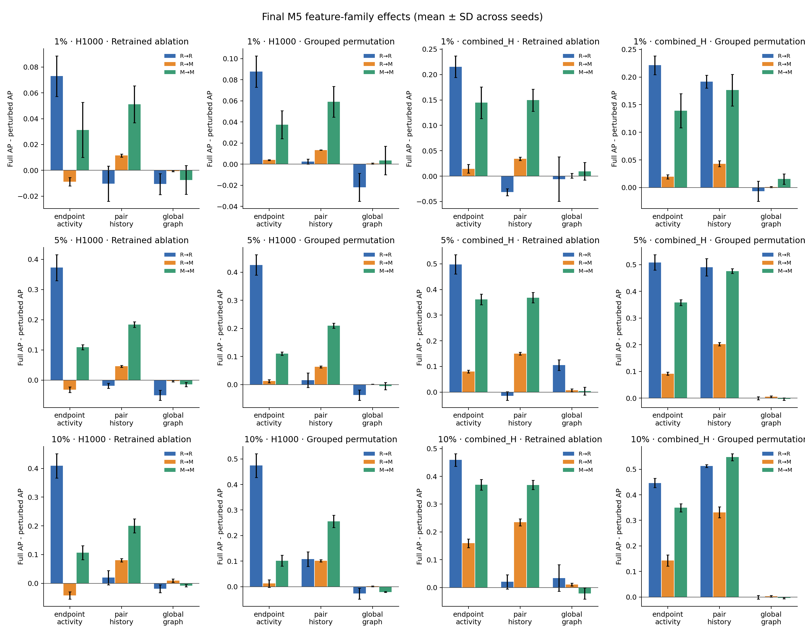

# Final M5：特征组影响分析

## 1. 实验结论范围

本实验使用冻结的 `strict_m2_m4_v1` 输入，覆盖注入率 [1, 5, 10]、seeds [42, 43, 44]、H1000/combined-H，以及 R→R、R→M、M→M。
每个上下文训练完整模型及三个删除特征组后的模型；所有模型均只使用 train 训练，并用训练条件对应的 validation 集重新校准 1% FPR 阈值。

完整模型通过冻结 M4 的跨平台漂移审计：**通过**。54 个上下文的 test event/时间/标签逐行完全一致；预测分数相关系数最低为 0.998921，平均绝对分数差最大为 0.005101，分类一致率最低为 0.986545。
冻结结果来自 macOS ARM/Python 3.9，本次 Final M5 来自 Linux x86/Python 3.11；随机森林跨平台重训并非 bitwise 相同。冻结 M4 只用于输入、协议和漂移审计，M5 的 full/ablation 配对比较全部来自同一当前环境。
指标漂移使用预先固定的灾难性漂移护栏，而不是把宽容差解释为数值等价；低正例率下 recall 会随少数样本跨过阈值而离散跳变。各指标最大绝对差如下。

| 指标 | 最大绝对差 | 护栏 |
|---|---:|---:|
| pr_auc | 0.010870 | 0.020000 |
| roc_auc | 0.001599 | 0.010000 |
| recall_at_validation_1pct_fpr | 0.113712 | 0.150000 |
| actual_test_fpr | 0.003261 | 0.010000 |
| actual_validation_fpr | 0.001589 | 0.010000 |
| threshold | 0.010000 | 0.020000 |

正的 AP drop 表示删除/打乱该组后性能下降；负值表示性能反而上升。后者可能来自相关特征替代、噪声或有限样本，不应直接解释为该组‘有害’。

## 2. 主要发现

- **跨生成器泛化明显下降。** 以 5% / combined-H 为例，完整模型 AP 从 R→R 的 0.6999 降至 R→M 的 0.2832；改用 matched 数据训练后，M→M 恢复到 0.5567。
- **随机异常成绩高度依赖端点活动。** 同一配置中，删除 endpoint activity 后 R→R 的 AP 平均下降 0.4980，说明随机生成器留下了强烈的活动量捷径。
- **matched 异常更依赖 pair history。** 5% / combined-H 的 R→M 中，删除 pair history 的 AP drop 为 0.1501，高于删除 endpoint activity 的 0.0804；M→M 中两者分别为 0.3683 与 0.3615。
- **global graph 不是稳定的主信号。** 它的消融和置换影响通常接近零、偶尔为负；结合相关特征替代问题，不能把负值解释为该组具有因果危害。
- **这些是模型侧关联证据。** M3 diagnostics 尚未冻结，所以目前不能把变化进一步归因于 neighborhood overlap、重复交互或 burstiness。

## 3. 完整模型结果

| 注入率 | 特征 | 设置 | AP | ROC-AUC | Recall@val-1%FPR | Test FPR |
|---:|---|---|---:|---:|---:|---:|
| 1% | H1000 | M→M | 0.0711 ± 0.0149 | 0.9008 ± 0.0124 | 0.0868 ± 0.0175 | 0.0065 ± 0.0009 |
| 1% | H1000 | R→M | 0.0251 ± 0.0008 | 0.8209 ± 0.0065 | 0.0028 ± 0.0049 | 0.0055 ± 0.0015 |
| 1% | H1000 | R→R | 0.1091 ± 0.0164 | 0.9471 ± 0.0090 | 0.0924 ± 0.0445 | 0.0041 ± 0.0007 |
| 1% | combined_H | M→M | 0.1922 ± 0.0297 | 0.9653 ± 0.0043 | 0.0224 ± 0.0318 | 0.0006 ± 0.0010 |
| 1% | combined_H | R→M | 0.0625 ± 0.0063 | 0.9241 ± 0.0079 | 0.0000 ± 0.0000 | 0.0013 ± 0.0006 |
| 1% | combined_H | R→R | 0.2649 ± 0.0175 | 0.9798 ± 0.0046 | 0.0840 ± 0.0468 | 0.0013 ± 0.0005 |
| 5% | H1000 | M→M | 0.2605 ± 0.0078 | 0.9086 ± 0.0060 | 0.0691 ± 0.0335 | 0.0058 ± 0.0021 |
| 5% | H1000 | R→M | 0.1163 ± 0.0019 | 0.8281 ± 0.0026 | 0.0028 ± 0.0035 | 0.0033 ± 0.0010 |
| 5% | H1000 | R→R | 0.5204 ± 0.0354 | 0.9688 ± 0.0035 | 0.0658 ± 0.0202 | 0.0026 ± 0.0003 |
| 5% | combined_H | M→M | 0.5567 ± 0.0132 | 0.9698 ± 0.0009 | 0.0897 ± 0.0286 | 0.0024 ± 0.0012 |
| 5% | combined_H | R→M | 0.2832 ± 0.0032 | 0.9358 ± 0.0033 | 0.0128 ± 0.0051 | 0.0039 ± 0.0006 |
| 5% | combined_H | R→R | 0.6999 ± 0.0286 | 0.9833 ± 0.0022 | 0.1215 ± 0.0726 | 0.0013 ± 0.0010 |
| 10% | H1000 | M→M | 0.3543 ± 0.0207 | 0.8974 ± 0.0102 | 0.0337 ± 0.0184 | 0.0038 ± 0.0022 |
| 10% | H1000 | R→M | 0.2130 ± 0.0053 | 0.8360 ± 0.0059 | 0.0047 ± 0.0042 | 0.0065 ± 0.0022 |
| 10% | H1000 | R→R | 0.6542 ± 0.0372 | 0.9655 ± 0.0009 | 0.1221 ± 0.1095 | 0.0039 ± 0.0028 |
| 10% | combined_H | M→M | 0.6794 ± 0.0148 | 0.9682 ± 0.0021 | 0.0610 ± 0.0259 | 0.0023 ± 0.0010 |
| 10% | combined_H | R→M | 0.4744 ± 0.0204 | 0.9411 ± 0.0039 | 0.0493 ± 0.0552 | 0.0056 ± 0.0062 |
| 10% | combined_H | R→R | 0.7774 ± 0.0199 | 0.9780 ± 0.0019 | 0.1491 ± 0.0828 | 0.0014 ± 0.0013 |

## 4. 重新训练消融：AP 变化

下表是 `完整模型 AP − 删除该组后 AP` 的跨 seed 均值和样本标准差。

| 注入率 | 特征 | 设置 | 删除组 | AP drop |
|---:|---|---|---|---:|
| 1% | H1000 | M→M | endpoint activity | 0.0313 ± 0.0214 |
| 1% | H1000 | M→M | global graph | -0.0075 ± 0.0111 |
| 1% | H1000 | M→M | pair history | 0.0511 ± 0.0143 |
| 1% | H1000 | R→M | endpoint activity | -0.0088 ± 0.0033 |
| 1% | H1000 | R→M | global graph | -0.0006 ± 0.0004 |
| 1% | H1000 | R→M | pair history | 0.0115 ± 0.0012 |
| 1% | H1000 | R→R | endpoint activity | 0.0730 ± 0.0157 |
| 1% | H1000 | R→R | global graph | -0.0106 ± 0.0081 |
| 1% | H1000 | R→R | pair history | -0.0103 ± 0.0137 |
| 1% | combined_H | M→M | endpoint activity | 0.1447 ± 0.0312 |
| 1% | combined_H | M→M | global graph | 0.0096 ± 0.0172 |
| 1% | combined_H | M→M | pair history | 0.1496 ± 0.0218 |
| 1% | combined_H | R→M | endpoint activity | 0.0145 ± 0.0087 |
| 1% | combined_H | R→M | global graph | 0.0007 ± 0.0047 |
| 1% | combined_H | R→M | pair history | 0.0342 ± 0.0034 |
| 1% | combined_H | R→R | endpoint activity | 0.2155 ± 0.0214 |
| 1% | combined_H | R→R | global graph | -0.0059 ± 0.0438 |
| 1% | combined_H | R→R | pair history | -0.0316 ± 0.0068 |
| 5% | H1000 | M→M | endpoint activity | 0.1092 ± 0.0083 |
| 5% | H1000 | M→M | global graph | -0.0143 ± 0.0068 |
| 5% | H1000 | M→M | pair history | 0.1840 ± 0.0093 |
| 5% | H1000 | R→M | endpoint activity | -0.0319 ± 0.0091 |
| 5% | H1000 | R→M | global graph | -0.0033 ± 0.0020 |
| 5% | H1000 | R→M | pair history | 0.0459 ± 0.0034 |
| 5% | H1000 | R→R | endpoint activity | 0.3725 ± 0.0427 |
| 5% | H1000 | R→R | global graph | -0.0502 ± 0.0164 |
| 5% | H1000 | R→R | pair history | -0.0188 ± 0.0081 |
| 5% | combined_H | M→M | endpoint activity | 0.3615 ± 0.0211 |
| 5% | combined_H | M→M | global graph | 0.0044 ± 0.0152 |
| 5% | combined_H | M→M | pair history | 0.3683 ± 0.0200 |
| 5% | combined_H | R→M | endpoint activity | 0.0804 ± 0.0055 |
| 5% | combined_H | R→M | global graph | 0.0070 ± 0.0058 |
| 5% | combined_H | R→M | pair history | 0.1501 ± 0.0057 |
| 5% | combined_H | R→R | endpoint activity | 0.4980 ± 0.0377 |
| 5% | combined_H | R→R | global graph | 0.1055 ± 0.0208 |
| 5% | combined_H | R→R | pair history | -0.0149 ± 0.0167 |
| 10% | H1000 | M→M | endpoint activity | 0.1069 ± 0.0244 |
| 10% | H1000 | M→M | global graph | -0.0082 ± 0.0042 |
| 10% | H1000 | M→M | pair history | 0.2002 ± 0.0246 |
| 10% | H1000 | R→M | endpoint activity | -0.0421 ± 0.0128 |
| 10% | H1000 | R→M | global graph | 0.0092 ± 0.0056 |
| 10% | H1000 | R→M | pair history | 0.0804 ± 0.0055 |
| 10% | H1000 | R→R | endpoint activity | 0.4089 ± 0.0425 |
| 10% | H1000 | R→R | global graph | -0.0190 ± 0.0134 |
| 10% | H1000 | R→R | pair history | 0.0199 ± 0.0250 |
| 10% | combined_H | M→M | endpoint activity | 0.3702 ± 0.0194 |
| 10% | combined_H | M→M | global graph | -0.0215 ± 0.0203 |
| 10% | combined_H | M→M | pair history | 0.3693 ± 0.0169 |
| 10% | combined_H | R→M | endpoint activity | 0.1591 ± 0.0153 |
| 10% | combined_H | R→M | global graph | 0.0106 ± 0.0053 |
| 10% | combined_H | R→M | pair history | 0.2348 ± 0.0125 |
| 10% | combined_H | R→R | endpoint activity | 0.4594 ± 0.0225 |
| 10% | combined_H | R→R | global graph | 0.0342 ± 0.0482 |
| 10% | combined_H | R→R | pair history | 0.0204 ± 0.0255 |

## 5. Grouped permutation importance

完整模型保持不变，同一组的全部列（包括 combined-H 的所有窗口）使用相同的 test-row 排列。先在每个 seed 内对 5 次 shuffle 求均值，再跨 seed 汇总。

| 注入率 | 特征 | 设置 | 打乱组 | AP drop |
|---:|---|---|---|---:|
| 1% | H1000 | M→M | endpoint activity | 0.0374 ± 0.0132 |
| 1% | H1000 | M→M | global graph | 0.0035 ± 0.0135 |
| 1% | H1000 | M→M | pair history | 0.0591 ± 0.0146 |
| 1% | H1000 | R→M | endpoint activity | 0.0039 ± 0.0005 |
| 1% | H1000 | R→M | global graph | 0.0007 ± 0.0005 |
| 1% | H1000 | R→M | pair history | 0.0134 ± 0.0002 |
| 1% | H1000 | R→R | endpoint activity | 0.0878 ± 0.0148 |
| 1% | H1000 | R→R | global graph | -0.0219 ± 0.0133 |
| 1% | H1000 | R→R | pair history | 0.0025 ± 0.0023 |
| 1% | combined_H | M→M | endpoint activity | 0.1392 ± 0.0309 |
| 1% | combined_H | M→M | global graph | 0.0154 ± 0.0091 |
| 1% | combined_H | M→M | pair history | 0.1765 ± 0.0285 |
| 1% | combined_H | R→M | endpoint activity | 0.0196 ± 0.0037 |
| 1% | combined_H | R→M | global graph | 0.0010 ± 0.0009 |
| 1% | combined_H | R→M | pair history | 0.0432 ± 0.0053 |
| 1% | combined_H | R→R | endpoint activity | 0.2213 ± 0.0170 |
| 1% | combined_H | R→R | global graph | -0.0066 ± 0.0182 |
| 1% | combined_H | R→R | pair history | 0.1918 ± 0.0116 |
| 5% | H1000 | M→M | endpoint activity | 0.1101 ± 0.0061 |
| 5% | H1000 | M→M | global graph | -0.0050 ± 0.0131 |
| 5% | H1000 | M→M | pair history | 0.2095 ± 0.0090 |
| 5% | H1000 | R→M | endpoint activity | 0.0127 ± 0.0056 |
| 5% | H1000 | R→M | global graph | 0.0014 ± 0.0007 |
| 5% | H1000 | R→M | pair history | 0.0632 ± 0.0032 |
| 5% | H1000 | R→R | endpoint activity | 0.4260 ± 0.0364 |
| 5% | H1000 | R→R | global graph | -0.0370 ± 0.0184 |
| 5% | H1000 | R→R | pair history | 0.0158 ± 0.0256 |
| 5% | combined_H | M→M | endpoint activity | 0.3580 ± 0.0111 |
| 5% | combined_H | M→M | global graph | -0.0029 ± 0.0047 |
| 5% | combined_H | M→M | pair history | 0.4760 ± 0.0086 |
| 5% | combined_H | R→M | endpoint activity | 0.0918 ± 0.0061 |
| 5% | combined_H | R→M | global graph | 0.0055 ± 0.0037 |
| 5% | combined_H | R→M | pair history | 0.2028 ± 0.0063 |
| 5% | combined_H | R→R | endpoint activity | 0.5084 ± 0.0286 |
| 5% | combined_H | R→R | global graph | 0.0002 ± 0.0058 |
| 5% | combined_H | R→R | pair history | 0.4907 ± 0.0324 |
| 10% | H1000 | M→M | endpoint activity | 0.1019 ± 0.0217 |
| 10% | H1000 | M→M | global graph | -0.0206 ± 0.0021 |
| 10% | H1000 | M→M | pair history | 0.2556 ± 0.0244 |
| 10% | H1000 | R→M | endpoint activity | 0.0123 ± 0.0145 |
| 10% | H1000 | R→M | global graph | 0.0014 ± 0.0012 |
| 10% | H1000 | R→M | pair history | 0.1018 ± 0.0045 |
| 10% | H1000 | R→R | endpoint activity | 0.4741 ± 0.0466 |
| 10% | H1000 | R→R | global graph | -0.0270 ± 0.0216 |
| 10% | H1000 | R→R | pair history | 0.1083 ± 0.0286 |
| 10% | combined_H | M→M | endpoint activity | 0.3494 ± 0.0160 |
| 10% | combined_H | M→M | global graph | -0.0041 ± 0.0030 |
| 10% | combined_H | M→M | pair history | 0.5474 ± 0.0137 |
| 10% | combined_H | R→M | endpoint activity | 0.1429 ± 0.0221 |
| 10% | combined_H | R→M | global graph | 0.0025 ± 0.0034 |
| 10% | combined_H | R→M | pair history | 0.3313 ± 0.0212 |
| 10% | combined_H | R→R | endpoint activity | 0.4464 ± 0.0184 |
| 10% | combined_H | R→R | global graph | -0.0009 ± 0.0073 |
| 10% | combined_H | R→R | pair history | 0.5126 ± 0.0052 |

## 6. 跨条件变化与 matched retraining recovery

`R→M − R→R` 衡量跨生成器性能变化；`M→M − R→M` 衡量在 matched 条件重新训练后的恢复。

| 注入率 | 特征 | 变体 | AP 跨条件变化 | AP retraining recovery |
|---:|---|---|---:|---:|
| 1% | H1000 | endpoint_activity | -0.0022 ± 0.0025 | 0.0058 ± 0.0091 |
| 1% | H1000 | global_graph | -0.0940 ± 0.0162 | 0.0528 ± 0.0255 |
| 1% | H1000 | none | -0.0840 ± 0.0158 | 0.0460 ± 0.0152 |
| 1% | H1000 | pair_history | -0.1058 ± 0.0292 | 0.0063 ± 0.0032 |
| 1% | combined_H | endpoint_activity | -0.0014 ± 0.0021 | -0.0005 ± 0.0058 |
| 1% | combined_H | global_graph | -0.2089 ± 0.0471 | 0.1208 ± 0.0431 |
| 1% | combined_H | none | -0.2024 ± 0.0125 | 0.1297 ± 0.0357 |
| 1% | combined_H | pair_history | -0.2681 ± 0.0045 | 0.0143 ± 0.0125 |
| 5% | H1000 | endpoint_activity | 0.0002 ± 0.0070 | 0.0031 ± 0.0035 |
| 5% | H1000 | global_graph | -0.4510 ± 0.0190 | 0.1552 ± 0.0143 |
| 5% | H1000 | none | -0.4042 ± 0.0364 | 0.1442 ± 0.0095 |
| 5% | H1000 | pair_history | -0.4688 ± 0.0427 | 0.0061 ± 0.0032 |
| 5% | combined_H | endpoint_activity | 0.0009 ± 0.0112 | -0.0076 ± 0.0105 |
| 5% | combined_H | global_graph | -0.3182 ± 0.0185 | 0.2760 ± 0.0090 |
| 5% | combined_H | none | -0.4167 ± 0.0254 | 0.2735 ± 0.0163 |
| 5% | combined_H | pair_history | -0.5817 ± 0.0337 | 0.0553 ± 0.0095 |
| 10% | H1000 | endpoint_activity | 0.0098 ± 0.0042 | -0.0077 ± 0.0044 |
| 10% | H1000 | global_graph | -0.4693 ± 0.0280 | 0.1587 ± 0.0158 |
| 10% | H1000 | none | -0.4412 ± 0.0336 | 0.1413 ± 0.0240 |
| 10% | H1000 | pair_history | -0.5017 ± 0.0490 | 0.0215 ± 0.0133 |
| 10% | combined_H | endpoint_activity | -0.0028 ± 0.0061 | -0.0059 ± 0.0091 |
| 10% | combined_H | global_graph | -0.2794 ± 0.0856 | 0.2372 ± 0.0189 |
| 10% | combined_H | none | -0.3030 ± 0.0327 | 0.2051 ± 0.0340 |
| 10% | combined_H | pair_history | -0.5174 ± 0.0627 | 0.0706 ± 0.0161 |

## 7. 如何解读这些证据

- Retrained ablation 询问：没有某组特征时，其余特征重新学习后还能达到什么性能。
- Grouped permutation 询问：已经训练好的完整模型当前依赖某组到什么程度。
- MDI 用于查看组内具体列，但会偏向高基数特征，并在相关特征之间分摊重要性，因此不作为主证据。
- 三个特征组并不统计独立；endpoint rank 与 pair rank 本身也依赖全图分布。
- `global_graph` 不是 common-neighbor/Jaccard neighborhood 特征，本报告不会把它改名为 neighborhood。

## 8. 尚未完成的机制解释

M3 的完整 diagnostics 尚未冻结，因此当前结果只能说明特征组与性能变化的关联。关于 neighborhood overlap、prior-pair residual、degree residual 和 temporal burstiness 的解释仍为 pending，不能从消融结果单独推出因果结论。

## 9. 局限

结果仅覆盖 UCI Messages、固定 TGF-style 特征、固定 Random Forest 和三个 injection/model seeds。Permutation repeats 表示 shuffle 波动，不是新的独立数据集。所有结论应限制在当前实验范围内。

