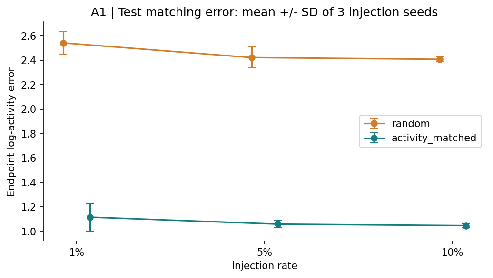
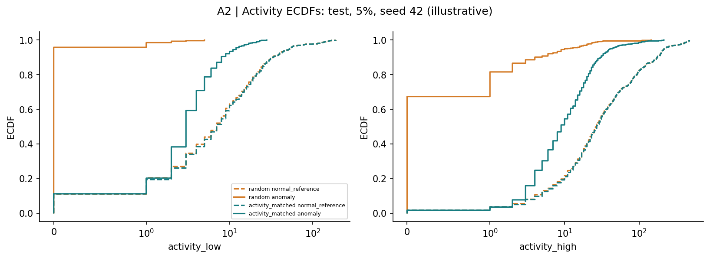
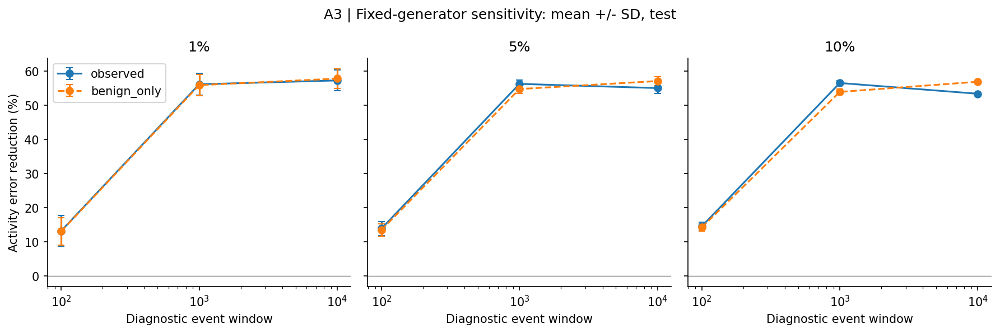
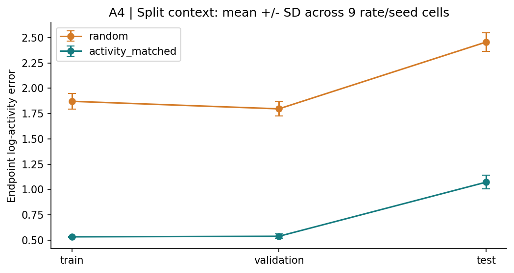
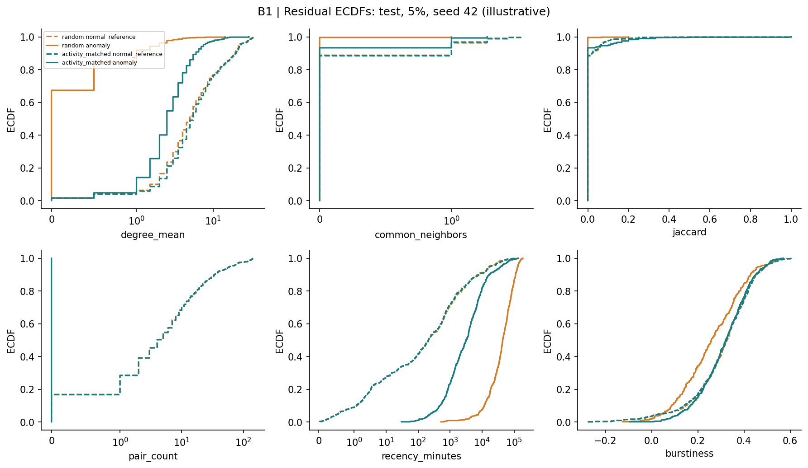
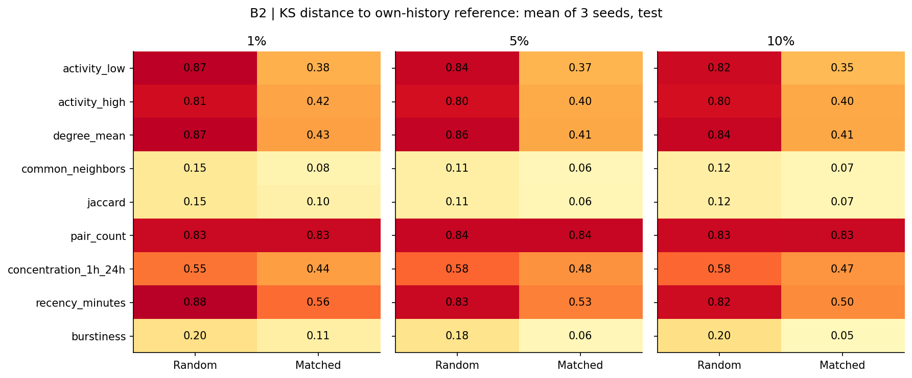
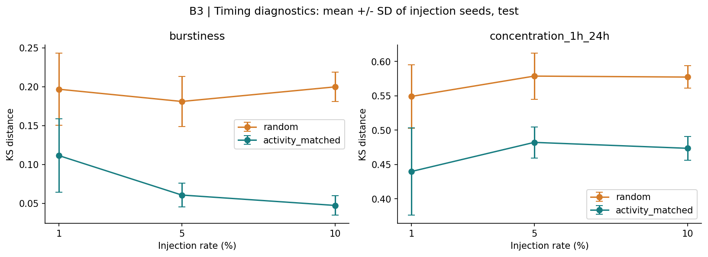

# M3 results: matching and residual differences

Generated from frozen strict M2/M4 streams. Primary: test split, observed history, 1000-event window.
All 18 conditions replayed; no model training, reinjection or test-based parameter selection.

## Member A: activity matching

| Rate | Random mean | Matched mean | Reduction mean ± seed SD | Reduction range |
|---|---:|---:|---:|---:|
| 1% | 2.5403 | 1.1139 | 56.20 ± 3.24% | 53.72–59.87% |
| 5% | 2.4210 | 1.0571 | 56.32 ± 1.06% | 55.64–57.54% |
| 10% | 2.4068 | 1.0449 | 56.58 ± 0.68% | 56.03–57.34% |

## Member A: sensitivity and common-history control

Sensitivity changes only the diagnostic window, not the generator. Benign-only is a counterfactual rescore of the same edges, not a new generator experiment.

| Window | Observed reduction (9-cell mean) | Common benign-history reduction |
|---|---:|---:|
| 100 | 13.92% | 13.63% |
| 1000 | 56.37% | 54.91% |
| 10000 | 55.29% | 57.32% |

The split figure mixes rate and seed variation (9 cells); it is descriptive drift context, not a confidence interval.

## Member B: residual structure and timing

| Metric | Random KS | Matched KS |
|---|---:|---:|
| activity_low | 0.8459 | 0.3656 |
| activity_high | 0.8041 | 0.4076 |
| degree_mean | 0.8545 | 0.4170 |
| common_neighbors | 0.1255 | 0.0713 |
| jaccard | 0.1255 | 0.0771 |
| pair_count | 0.8332 | 0.8350 |
| concentration_1h_24h | 0.5683 | 0.4652 |
| recency_minutes | 0.8440 | 0.5308 |
| burstiness | 0.1926 | 0.0732 |

Distances above average the nine rate/seed cells. ECDF panels show only 5%, seed 42. Each anomaly group has its own-history normal reference; the dashed curves are intentionally distinct.

### Missingness and novelty

- random normal reference repeat-pair fraction: 83.32%; injected pairs: 0% by construction.
- random / normal_reference burstiness missing fraction: 6.84% (mean of nine cells). Distances exclude missing values; do not read them as population-wide equivalence.
- random / anomaly burstiness missing fraction: 42.47% (mean of nine cells). Distances exclude missing values; do not read them as population-wide equivalence.
- activity_matched normal reference repeat-pair fraction: 83.50%; injected pairs: 0% by construction.
- activity_matched / normal_reference burstiness missing fraction: 7.28% (mean of nine cells). Distances exclude missing values; do not read them as population-wide equivalence.
- activity_matched / anomaly burstiness missing fraction: 11.70% (mean of nine cells). Distances exclude missing values; do not read them as population-wide equivalence.

## Joint interpretation and M5 handoff

Activity matching improves the intended endpoint statistic, but residual differences remain. Novel-pair rules leave a large pair-history discrepancy; timing and degree are not fully matched. These are diagnostic associations, not evidence that a classifier uses a given shortcut.
The current remote M5 package uses legacy `results/full_pipeline` and its 70/30/current-event-inclusive protocol. This M3 uses `results/final_m2_m4` and strict pre-timestamp features with 60/20/20 splits. Do not join their scores or claim a controlled feature-level explanation until M5 is rerun on the strict package.
Common neighbors/Jaccard and timing diagnostics are not predictor columns in the current TGF-style classifier. Recommend a strict-protocol pair-history ablation and endpoint-activity ablation; do not rename global_graph as neighborhood.

## Limits

Three injection seeds on one dataset; temporally dependent samples; sampled reference edges are not a uniform sample of all normal edges. SD is descriptive, not a confidence interval. No p-values are reported. Endpoint burstiness uses the last at most 20 intervals with >=5 required, population SD; zero-interval/all-zero cases are explicitly handled. Concentration is a separate 1h/24h proxy. Window/history controls are post-hoc descriptive checks and cannot tune M2 on test data.

Reproduction and ownership: [docs/M3.md](../../docs/M3.md). Tables retain every split, window, policy and seed. Input/source/environment/output hashes: [manifest.json](manifest.json).
