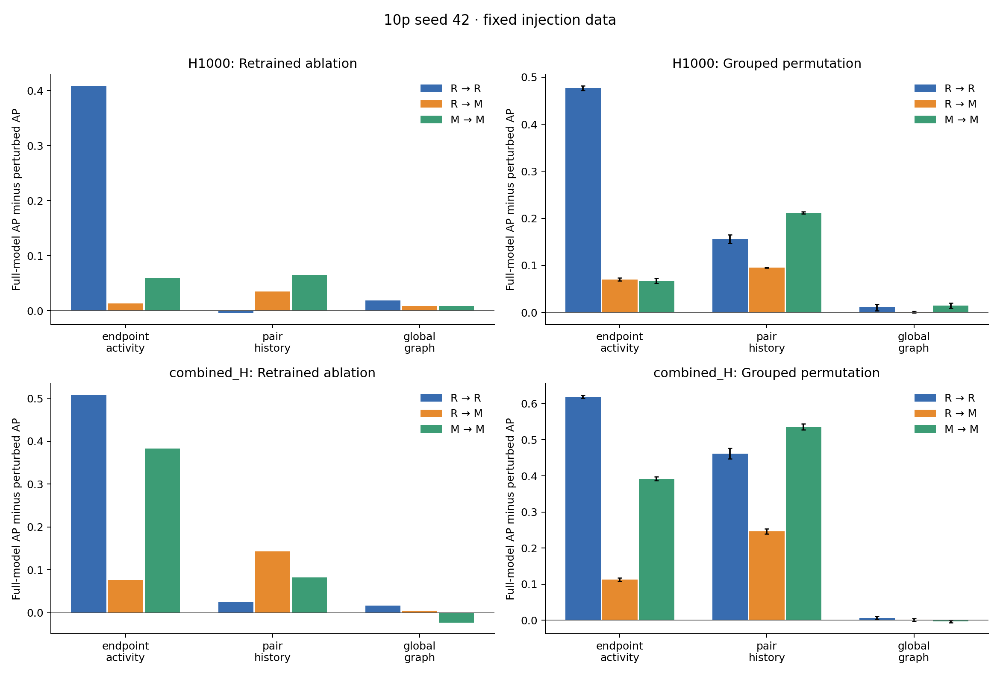

# M5: fixed-data feature analysis

Existing seed-42 injection data; feature groups are a local proposal. No generator changes.

PR-AUC below means average precision, following the existing M4 implementation.

## Retrained ablations

Positive drop means removing a group reduced performance; negative means performance increased.

| Features | Setting | Removed group | PR-AUC | PR drop | ROC-AUC | ROC drop |
|---|---|---|---:|---:|---:|---:|
| H1000 | R → R | none | 0.650707 | +0.000000 | 0.963149 | +0.000000 |
| H1000 | R → R | endpoint_activity | 0.241611 | +0.409097 | 0.848363 | +0.114786 |
| H1000 | R → R | pair_history | 0.654829 | -0.004122 | 0.961761 | +0.001388 |
| H1000 | R → R | global_graph | 0.632297 | +0.018411 | 0.960571 | +0.002578 |
| H1000 | R → M | none | 0.256815 | +0.000000 | 0.842536 | +0.000000 |
| H1000 | R → M | endpoint_activity | 0.243374 | +0.013441 | 0.845170 | -0.002634 |
| H1000 | R → M | pair_history | 0.221972 | +0.034842 | 0.740544 | +0.101992 |
| H1000 | R → M | global_graph | 0.248334 | +0.008481 | 0.826295 | +0.016241 |
| H1000 | M → M | none | 0.316328 | +0.000000 | 0.883229 | +0.000000 |
| H1000 | M → M | endpoint_activity | 0.257335 | +0.058994 | 0.854616 | +0.028613 |
| H1000 | M → M | pair_history | 0.251286 | +0.065042 | 0.806413 | +0.076815 |
| H1000 | M → M | global_graph | 0.308019 | +0.008309 | 0.881123 | +0.002105 |
| combined_H | R → R | none | 0.875920 | +0.000000 | 0.988523 | +0.000000 |
| combined_H | R → R | endpoint_activity | 0.368415 | +0.507505 | 0.910527 | +0.077996 |
| combined_H | R → R | pair_history | 0.850131 | +0.025789 | 0.983243 | +0.005280 |
| combined_H | R → R | global_graph | 0.859108 | +0.016812 | 0.987525 | +0.000998 |
| combined_H | R → M | none | 0.396210 | +0.000000 | 0.905541 | +0.000000 |
| combined_H | R → M | endpoint_activity | 0.319439 | +0.076770 | 0.895127 | +0.010414 |
| combined_H | R → M | pair_history | 0.253661 | +0.142549 | 0.722237 | +0.183304 |
| combined_H | R → M | global_graph | 0.391153 | +0.005057 | 0.904265 | +0.001276 |
| combined_H | M → M | none | 0.718210 | +0.000000 | 0.968825 | +0.000000 |
| combined_H | M → M | endpoint_activity | 0.335581 | +0.382629 | 0.901671 | +0.067154 |
| combined_H | M → M | pair_history | 0.636221 | +0.081989 | 0.942052 | +0.026772 |
| combined_H | M → M | global_graph | 0.740946 | -0.022735 | 0.971571 | -0.002746 |

## Group permutation importance

The full model is held fixed. All columns in a group share one row permutation, across H windows as well.
Error bars are standard deviations over shuffles, not across independently generated datasets.

| Features | Setting | Group | Mean PR drop | Shuffle SD |
|---|---|---|---:|---:|
| H1000 | M → M | endpoint_activity | +0.067092 | 0.005358 |
| H1000 | M → M | global_graph | +0.014398 | 0.005490 |
| H1000 | M → M | pair_history | +0.211737 | 0.002381 |
| H1000 | R → M | endpoint_activity | +0.070374 | 0.003030 |
| H1000 | R → M | global_graph | +0.000719 | 0.001801 |
| H1000 | R → M | pair_history | +0.095200 | 0.000794 |
| H1000 | R → R | endpoint_activity | +0.476737 | 0.005198 |
| H1000 | R → R | global_graph | +0.010996 | 0.006928 |
| H1000 | R → R | pair_history | +0.156417 | 0.008913 |
| combined_H | M → M | endpoint_activity | +0.392233 | 0.005377 |
| combined_H | M → M | global_graph | -0.003642 | 0.002516 |
| combined_H | M → M | pair_history | +0.536146 | 0.008050 |
| combined_H | R → M | endpoint_activity | +0.112652 | 0.004873 |
| combined_H | R → M | global_graph | +0.000962 | 0.003963 |
| combined_H | R → M | pair_history | +0.246320 | 0.007162 |
| combined_H | R → R | endpoint_activity | +0.619283 | 0.004473 |
| combined_H | R → R | global_graph | +0.006755 | 0.004080 |
| combined_H | R → R | pair_history | +0.461826 | 0.014850 |

## Baseline check

All full-model metrics match saved M4 within 1e-10: **True**.

## Interpretation boundaries

- Ablation measures the effect of retraining without a family; permutation measures dependence of the fitted full model. They need not agree.
- Correlated families can substitute for one another. Neither analysis proves a causal mechanism.
- The global_graph group is not a neighborhood-overlap group; no such predictor exists in these tables.
- One injection seed is available. No population uncertainty or independent-seed robustness is claimed.
- Recall follows M4's test-negative quantile threshold, including ties. This is descriptive, not a validation-calibrated operating threshold; actual FPR is in ablations.csv.
- Existing row-based 70/30 splits and history conventions are retained for comparability, pending M2/M4 alignment.
- M3 diagnostics are needed to link model behavior to the generator's residual distribution differences.

