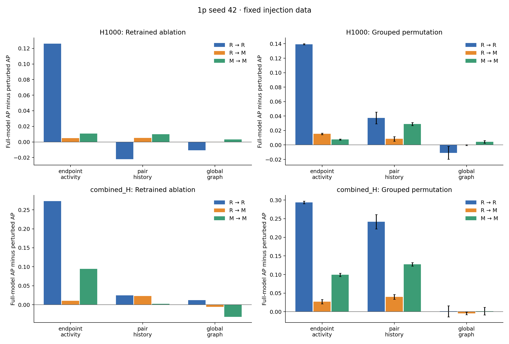

# M5: fixed-data feature analysis

Existing seed-42 injection data; feature groups are a local proposal. No generator changes.

PR-AUC below means average precision, following the existing M4 implementation.

## Retrained ablations

Positive drop means removing a group reduced performance; negative means performance increased.

| Features | Setting | Removed group | PR-AUC | PR drop | ROC-AUC | ROC drop |
|---|---|---|---:|---:|---:|---:|
| H1000 | R → R | none | 0.158868 | +0.000000 | 0.959089 | +0.000000 |
| H1000 | R → R | endpoint_activity | 0.032714 | +0.126153 | 0.842976 | +0.116113 |
| H1000 | R → R | pair_history | 0.181126 | -0.022259 | 0.961039 | -0.001950 |
| H1000 | R → R | global_graph | 0.169459 | -0.010591 | 0.963045 | -0.003956 |
| H1000 | R → M | none | 0.034903 | +0.000000 | 0.818537 | +0.000000 |
| H1000 | R → M | endpoint_activity | 0.030010 | +0.004893 | 0.840381 | -0.021844 |
| H1000 | R → M | pair_history | 0.029632 | +0.005271 | 0.723311 | +0.095226 |
| H1000 | R → M | global_graph | 0.034781 | +0.000122 | 0.827056 | -0.008519 |
| H1000 | M → M | none | 0.043578 | +0.000000 | 0.869803 | +0.000000 |
| H1000 | M → M | endpoint_activity | 0.032901 | +0.010677 | 0.843488 | +0.026315 |
| H1000 | M → M | pair_history | 0.033632 | +0.009946 | 0.795187 | +0.074616 |
| H1000 | M → M | global_graph | 0.040442 | +0.003136 | 0.867964 | +0.001839 |
| combined_H | R → R | none | 0.329575 | +0.000000 | 0.979965 | +0.000000 |
| combined_H | R → R | endpoint_activity | 0.056563 | +0.273012 | 0.911552 | +0.068413 |
| combined_H | R → R | pair_history | 0.304729 | +0.024846 | 0.974109 | +0.005856 |
| combined_H | R → R | global_graph | 0.317412 | +0.012163 | 0.978069 | +0.001896 |
| combined_H | R → M | none | 0.063537 | +0.000000 | 0.883721 | +0.000000 |
| combined_H | R → M | endpoint_activity | 0.052845 | +0.010692 | 0.908395 | -0.024674 |
| combined_H | R → M | pair_history | 0.040184 | +0.023353 | 0.709256 | +0.174465 |
| combined_H | R → M | global_graph | 0.068867 | -0.005330 | 0.893871 | -0.010150 |
| combined_H | M → M | none | 0.151827 | +0.000000 | 0.943647 | +0.000000 |
| combined_H | M → M | endpoint_activity | 0.057142 | +0.094685 | 0.908844 | +0.034803 |
| combined_H | M → M | pair_history | 0.149129 | +0.002697 | 0.899473 | +0.044174 |
| combined_H | M → M | global_graph | 0.183321 | -0.031495 | 0.952493 | -0.008847 |

## Group permutation importance

The full model is held fixed. All columns in a group share one row permutation, across H windows as well.
Error bars are standard deviations over shuffles, not across independently generated datasets.

| Features | Setting | Group | Mean PR drop | Shuffle SD |
|---|---|---|---:|---:|
| H1000 | M → M | endpoint_activity | +0.007622 | 0.000785 |
| H1000 | M → M | global_graph | +0.004368 | 0.001841 |
| H1000 | M → M | pair_history | +0.028961 | 0.001998 |
| H1000 | R → M | endpoint_activity | +0.015391 | 0.001061 |
| H1000 | R → M | global_graph | -0.000235 | 0.000640 |
| H1000 | R → M | pair_history | +0.008449 | 0.003219 |
| H1000 | R → R | endpoint_activity | +0.139339 | 0.000863 |
| H1000 | R → R | global_graph | -0.010819 | 0.008998 |
| H1000 | R → R | pair_history | +0.037398 | 0.008134 |
| combined_H | M → M | endpoint_activity | +0.099192 | 0.004613 |
| combined_H | M → M | global_graph | +0.001637 | 0.010253 |
| combined_H | M → M | pair_history | +0.127565 | 0.004514 |
| combined_H | R → M | endpoint_activity | +0.026900 | 0.005791 |
| combined_H | R → M | global_graph | -0.004401 | 0.003759 |
| combined_H | R → M | pair_history | +0.040076 | 0.006450 |
| combined_H | R → R | endpoint_activity | +0.293855 | 0.003454 |
| combined_H | R → R | global_graph | +0.001202 | 0.014626 |
| combined_H | R → R | pair_history | +0.241640 | 0.019122 |

## Baseline check

All full-model metrics match saved M4 within 1e-10: **True**.

## Interpretation boundaries

- Ablation measures the effect of retraining without a family; permutation measures dependence of the fitted full model. They need not agree.
- Correlated families can substitute for one another. Neither analysis proves a causal mechanism.
- The global_graph group is not a neighborhood-overlap group; no such predictor exists in these tables.
- One injection seed is available. No population uncertainty or independent-seed robustness is claimed.
- Recall follows M4's test-negative quantile threshold, including ties. This is descriptive, not a validation-calibrated operating threshold; actual FPR is in ablations.csv.
- Existing row-based 70/30 splits and history conventions are retained for comparability, pending M2/M4 alignment.
- M3 diagnostics are needed to link model behavior to the generator's residual distribution differences.

