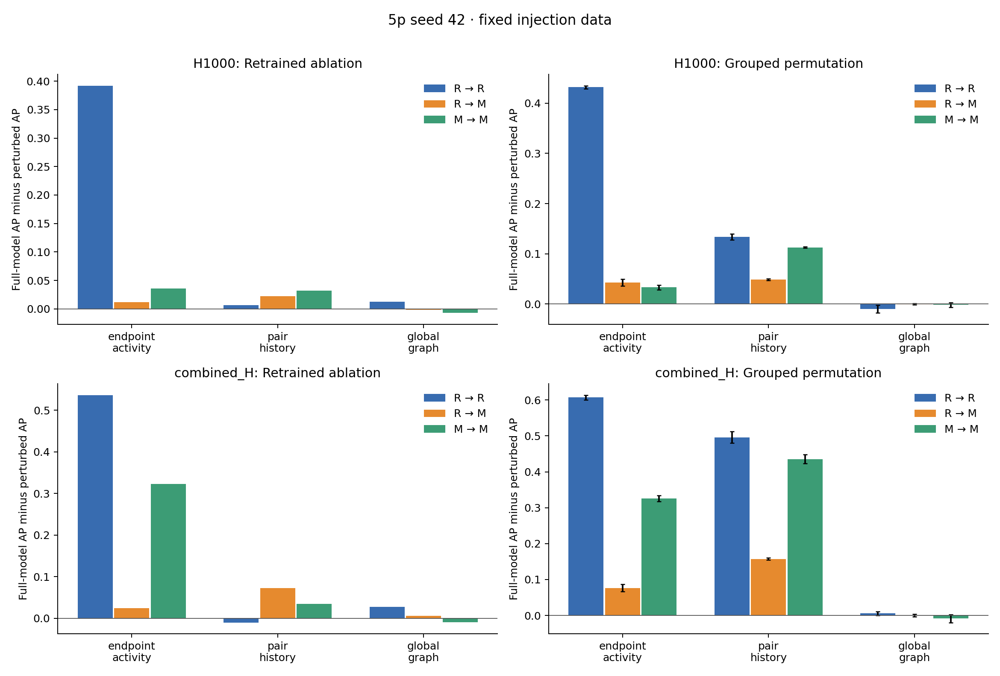

# M5: fixed-data feature analysis

Existing seed-42 injection data; feature groups are a local proposal. No generator changes.

PR-AUC below means average precision, following the existing M4 implementation.

## Retrained ablations

Positive drop means removing a group reduced performance; negative means performance increased.

| Features | Setting | Removed group | PR-AUC | PR drop | ROC-AUC | ROC drop |
|---|---|---|---:|---:|---:|---:|
| H1000 | R → R | none | 0.522872 | +0.000000 | 0.966832 | +0.000000 |
| H1000 | R → R | endpoint_activity | 0.130814 | +0.392057 | 0.835421 | +0.131411 |
| H1000 | R → R | pair_history | 0.516099 | +0.006772 | 0.965925 | +0.000907 |
| H1000 | R → R | global_graph | 0.510021 | +0.012850 | 0.966244 | +0.000587 |
| H1000 | R → M | none | 0.140232 | +0.000000 | 0.828334 | +0.000000 |
| H1000 | R → M | endpoint_activity | 0.128299 | +0.011933 | 0.834533 | -0.006199 |
| H1000 | R → M | pair_history | 0.117599 | +0.022634 | 0.720458 | +0.107876 |
| H1000 | R → M | global_graph | 0.141927 | -0.001695 | 0.827500 | +0.000834 |
| H1000 | M → M | none | 0.174004 | +0.000000 | 0.874993 | +0.000000 |
| H1000 | M → M | endpoint_activity | 0.138512 | +0.035493 | 0.841860 | +0.033133 |
| H1000 | M → M | pair_history | 0.141894 | +0.032110 | 0.797925 | +0.077069 |
| H1000 | M → M | global_graph | 0.181329 | -0.007325 | 0.880513 | -0.005520 |
| combined_H | R → R | none | 0.760949 | +0.000000 | 0.986913 | +0.000000 |
| combined_H | R → R | endpoint_activity | 0.224528 | +0.536421 | 0.907061 | +0.079852 |
| combined_H | R → R | pair_history | 0.771163 | -0.010214 | 0.985364 | +0.001549 |
| combined_H | R → R | global_graph | 0.733866 | +0.027083 | 0.986282 | +0.000632 |
| combined_H | R → M | none | 0.241567 | +0.000000 | 0.897047 | +0.000000 |
| combined_H | R → M | endpoint_activity | 0.217054 | +0.024513 | 0.904833 | -0.007786 |
| combined_H | R → M | pair_history | 0.169060 | +0.072507 | 0.718296 | +0.178751 |
| combined_H | R → M | global_graph | 0.236176 | +0.005391 | 0.895857 | +0.001190 |
| combined_H | M → M | none | 0.525322 | +0.000000 | 0.953539 | +0.000000 |
| combined_H | M → M | endpoint_activity | 0.203029 | +0.322293 | 0.899643 | +0.053896 |
| combined_H | M → M | pair_history | 0.491085 | +0.034237 | 0.936569 | +0.016970 |
| combined_H | M → M | global_graph | 0.534574 | -0.009253 | 0.956280 | -0.002741 |

## Group permutation importance

The full model is held fixed. All columns in a group share one row permutation, across H windows as well.
Error bars are standard deviations over shuffles, not across independently generated datasets.

| Features | Setting | Group | Mean PR drop | Shuffle SD |
|---|---|---|---:|---:|
| H1000 | M → M | endpoint_activity | +0.033243 | 0.004769 |
| H1000 | M → M | global_graph | -0.001792 | 0.004430 |
| H1000 | M → M | pair_history | +0.112753 | 0.001194 |
| H1000 | R → M | endpoint_activity | +0.042716 | 0.007054 |
| H1000 | R → M | global_graph | -0.000206 | 0.001587 |
| H1000 | R → M | pair_history | +0.048526 | 0.001716 |
| H1000 | R → R | endpoint_activity | +0.431776 | 0.003104 |
| H1000 | R → R | global_graph | -0.010116 | 0.007837 |
| H1000 | R → R | pair_history | +0.133487 | 0.006086 |
| combined_H | M → M | endpoint_activity | +0.325793 | 0.008343 |
| combined_H | M → M | global_graph | -0.008497 | 0.010995 |
| combined_H | M → M | pair_history | +0.435665 | 0.012831 |
| combined_H | R → M | endpoint_activity | +0.076354 | 0.010120 |
| combined_H | R → M | global_graph | +0.000501 | 0.003379 |
| combined_H | R → M | pair_history | +0.157365 | 0.003251 |
| combined_H | R → R | endpoint_activity | +0.606953 | 0.006717 |
| combined_H | R → R | global_graph | +0.005728 | 0.005384 |
| combined_H | R → R | pair_history | +0.496251 | 0.015563 |

## Baseline check

All full-model metrics match saved M4 within 1e-10: **True**.

## Interpretation boundaries

- Ablation measures the effect of retraining without a family; permutation measures dependence of the fitted full model. They need not agree.
- Correlated families can substitute for one another. Neither analysis proves a causal mechanism.
- The global_graph group is not a neighborhood-overlap group; no such predictor exists in these tables.
- One injection seed is available. No population uncertainty or independent-seed robustness is claimed.
- Recall follows M4's test-negative quantile threshold, including ties. This is descriptive, not a validation-calibrated operating threshold; actual FPR is in ablations.csv.
- Existing row-based 70/30 splits and history conventions are retained for comparability, pending M2/M4 alignment.
- M3 diagnostics are needed to link model behavior to the generator's residual distribution differences.

